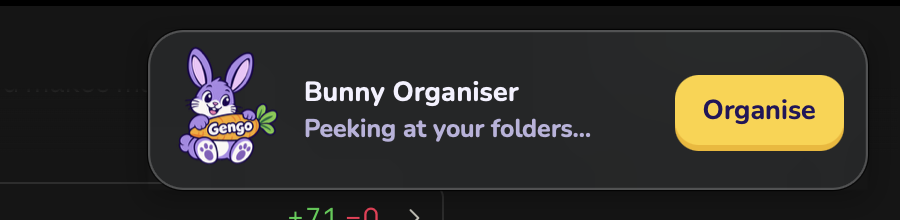

# Mr. Box 📦

A notification-sized Mac assistant that keeps your design-school files tidy. Press **Organise** and Mr. Box tidies up
`~/Downloads`, `~/Desktop` and `~/Documents`, works out which project each new file belongs to (using the
`claude` CLI), and files it into a dated project template.



## Download

**[⬇️ Download Mr. Box for Mac](https://github.com/praneet-admin/mr-box/releases/latest/download/Mr-Box-macOS.zip)** (1.5 MB, macOS 12 or later)

1. Open the downloaded zip and drag **Mr Box** into your **Applications** folder.
2. Double-click it. macOS will warn that it's from an unidentified developer (it isn't notarised yet).
   Go to **System Settings → Privacy & Security**, scroll down, and click **Open Anyway**. You only do this once.
3. Mr. Box appears in the top-right corner. Click **Allow** when he asks to see Downloads, Desktop and Documents.

**Search** works straight away. **Organise** also needs the [Claude Code CLI](https://claude.com/claude-code)
installed and logged in, because Claude decides which project each file belongs to.

## The folder template

```
~/2026/
  10_October/
    Project_Name/
      01_Research/
      02_Inspiration/
      03_Assets/      Images · Icons · Illustrations · Logos · Fonts · Templates
      04_Working_Files/  V01 · V02 · V03 · V04 · V05
      05_Exports/     JPG · PNG · PDF · SVG
      06_Mockups/
      07_Final/
      99_Archive/
```

- Files for an existing project go into that project's folder; a new project starts in the current month.
- Personal items go to `~/Personal`, installers to `~/Installers`, and anything unclear to `~/2026/_To_Review`.
- Files touched in the last 10 minutes are left alone, so half-finished downloads are never grabbed.
- Every move is logged to `~/2026/_move_log.tsv`. `undo_moves.sh` puts everything back.

## Using it

| | |
|---|---|
| **Organise** | Sort everything that's waiting |
| **Option-click Organise** | Preview where files *would* go without moving anything |
| **× (top-left)** | Quit Mr. Box — reopen it from Spotlight |
| **Drag** | Grab Mr. Box anywhere (not on a button) to move him; he remembers the spot. Double-click him to send him back to the top-right corner |
| **Click the status after a run** | Open the organised folders in Finder |
| **🔍 or ⌘F** | Search everything — file names and words inside documents. ↑↓ to pick, ↩ to open, ⌘↩ to show in Finder, Esc to close |

The first time you press Organise, macOS asks for access to Downloads, Desktop and Documents. Click **Allow**.

From the terminal:

```bash
python3 organize.py --list      # what's waiting
python3 organize.py --dry-run   # plan only
python3 organize.py             # organise
"$HOME/Applications/Mr Box.app/Contents/MacOS/MrBox" --search "zo hotel"   # test search
```

## Build

Needs macOS 12+, the Xcode command-line tools (`swiftc`) and the [Claude Code CLI](https://claude.com/claude-code)
logged in at `~/.local/bin/claude`.

```bash
./build.sh   # builds ~/Applications/Mr Box.app
```

The app expects the organiser at `~/2026/_organize_new.py`. Link it once:

```bash
mkdir -p ~/2026 && ln -sf "$PWD/organize.py" ~/2026/_organize_new.py
```

## Files

| File | What it is |
|---|---|
| `main.swift` | Floating banner (WKWebView) that runs the organiser and does Spotlight search |
| `index.html` | The banner UI |
| `organize.py` | Finds new files, asks `claude -p` to classify them, moves them |
| `undo_moves.sh` | Reverses every logged move |
| `build.sh` | Compiles, adds the icon and Info.plist, ad-hoc signs |
